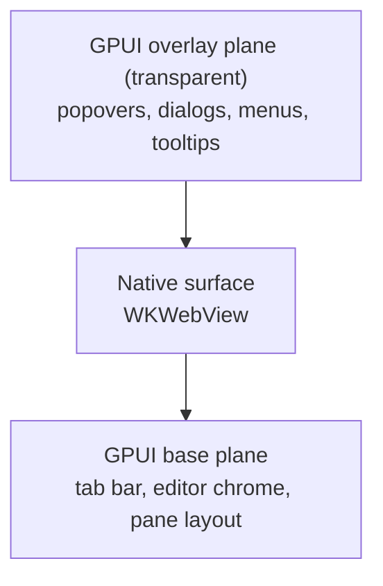

# Plan: an embedded browser tab in Zed (macOS, localhost)

Status: draft for review. Nothing started yet.
Scope: a fork of Zed on macOS. Not the UnderCover product, not `docs/`.
Research snapshot: 4 Nov 2026. The Appendices hold the evidence behind every decision here; read
them before re-litigating anything.

## Goal

A tab in Zed that shows a page from `http://localhost:<port>`, that you can use as the only
place you look at the app you're building, and that the agent can drive.

- the page resizes with the pane, and disappears when its tab isn't active;
- typing in the address bar and typing into the page don't fight each other;
- the command palette, menus and dialogs draw **above** the page;
- the agent can open a URL in it, read the page, and screenshot it.

**Definition of done:** `cargo run -p zed` opens a source-built Zed, `browser: open` puts
`http://localhost:3000` in a tab, you click through it, `cmd-shift-p` opens the palette on top of
the page, and the agent opens a different route in the same tab from its own tool.

## Non-goals

Deliberately excluded, and each one is what keeps the estimate in days rather than weeks:

- **The web at large.** No Google sign-in, no extensions, no DRM. Embedded WebKit is refused by
  Google's flows and has no extension system; that's fine, because nothing you develop locally
  needs either. If that changes, the engine decision changes with it — see Risks.
- **Chrome DevTools Protocol.** Not needed for localhost. If we later want Playwright or the
  DevTools MCP to attach to the pane itself, that's the Chromium conversation again.
- **Windows and Linux.** Linux is WebKitGTK plus GTK's event loop plus a reparentable X window
  that Wayland doesn't have — every reference implementation drops it.
- Upstreaming. Neither #61945 (closed by its author) nor #62379 (still open) has merged; this is a
  fork, and the merge odds are someone else's decision.

## Where this runs

Anything that compiles, builds or launches runs on the **M5 Mac**, never on Windows.

| Work | Machine |
|---|---|
| Clone, `cargo run`, `cargo check`, `cargo build` — any `cargo` at all | M5 (macOS) |
| Editing this plan, reading the PR and reference code, `git fetch` | Either |

None of this is runnable on Windows: Zed's build wants the MSVC toolchain and a very large
compile, and the browser crate is macOS-only Apple frameworks. Don't attempt a Windows build to
"check quickly" — a partial MSVC compile tells you nothing about the macOS result.

The plan lives on `spike/browser` in `deXterbed/zed`; edit it there. The copy in the UnderCover
repo is a working draft and can be deleted once you are working from the clone.

## Architecture

GPUI paints the whole window itself on the GPU, so a web page can't be one of its draw calls. The
page is a **native view floating above GPUI's surface**, repositioned to the pane's rectangle
every frame, with the window split into three planes so GPUI content can still appear both under
and over it:



The middle layer comes from PR #62379 (`Window::enable_window_composition`). Without it, anything
GPUI draws over the page is hidden behind it — which is the difference between a tool and a
nuisance.

## Why this base

| Base | Menus over the page | Cost |
|---|---|---|
| Zed main today | Broken, needs a freeze-a-screenshot hack | Cheapest to start, worst result |
| **Zed + PR #61945** | Correct, macOS + Windows only | Superseded; closed by its author |
| **Zed + PR #62379 `@ 840e095`** | Correct, macOS + Windows + Linux | Rebase a 26-commit unmerged PR onto moving `main` |

**Start from PR #62379's head for the spike**; move onto current `main` later if it earns it
(Phase 7). #62379 supersedes #61945: the earlier PR only lifted deferred overlays above one native
child view on two platforms; this one adds a composition tree that also orders, nests and
reparents surfaces, and covers Wayland (`wl_subsurface`) and X11 (child window with SHAPE
cutouts). Its author closed #61945 in Sep 2026 and names #62379 as the recommended branch.

It ships its own proof-of-concept, so the question is answered before any code is written. This plan
lives on branch `spike/browser` in your own fork, `deXterbed/zed`; the branch is currently one
commit of documentation on top of upstream `main`, and the rebase below moves it onto the
composition tree. Nothing needs to be cloned on Windows.

```sh
git clone https://github.com/deXterbed/zed.git
cd zed
git remote add comp https://github.com/huacnlee/zed.git
git fetch comp window-composition-tree
git switch spike/browser
git rebase --onto 840e095 main spike/browser   # moves only the PLAN.md commit onto the PR head
cargo run -p gpui --example native_webview
```

Three references worth reading before writing anything:

- **`unicornops/zmail`** — a GPUI mail client that embeds a locked-down `WKWebView` for HTML mail,
  pinned to that same rev, with the integration written up in `docs/upstream/zed.md`. The closest
  match to what we want, on the current API.
- **`longbridge/gpui-fast`** — the author's own downstream fork, where the composition tree also
  lives (`crates/gpui/src/fast/composition.rs`), alongside a `native_webview` example and a
  `docs/upstream-sync.md` describing how its API differs from the PR.
- **`egoist/waku`** — older, built on #61945, macOS-only, but `src/browser.rs` is still the best
  worked example of the webview surface itself: omnibox, geometry sync, focus handoff, devtools,
  downloads. GPL-3.0-only, same family as Zed, so lifting code is compatible — keep the attribution.

## Phase 0 — prove the base (30–60 min)

The commands above. → **verify:** a window opens with a live `WKWebView`, and a GPUI popover draws
*over* the page. Click outside the popover, geometrically over the page — it dismisses.

If that example doesn't work, stop: everything below assumes it. Then `cargo run -p zed` →
**verify:** Zed opens from source. That's your baseline.

## Phase 1 — the one gate (half day)

The webview needs the window's `NSView`. #62379 gives you a composition surface, but its handle is
untyped: `platform_handle()` returns a `Box<dyn Any>` wrapping a `usize` `NSView` pointer, and every
embedder casts it unsafely against an undocumented contract (zmail filed exactly this as
feedback). So the gate is narrow: can our crate get from "create a composition surface" to "an
`NSView` that `wry` will accept as a parent"?

```sh
rg -n "enable_window_composition|with_composition_surface|platform_handle" crates/gpui/src | head -40
```

Then, in a throwaway `crates/browser/examples/window_handle.rs`:

1. `window.enable_window_composition()`;
2. create a surface with `with_composition_surface(...)`;
3. take `platform_handle()`, downcast the `Box<dyn Any>` to the pointer, cast to `&NSView`;
4. hand it to `wry`'s `build_as_child` and load `about:blank`.

→ **verify:** a blank webview opens inside the window, and the process doesn't crash on the cast.

Two acceptable outcomes:

- keep the unsafe cast, isolated in one function with a comment pointing at the upstream PR;
- or add a typed accessor shaped like `raw_window_handle`'s `AppKitWindowHandle` — which is also what
  zmail asked for, and worth doing if you ever intend to submit anything.

**This is the only real gate.** If the cast or the parenting fights you, stop and reassess rather
than pushing through.

## Phase 2 — `crates/browser` with a page in it (1–2 days)

New workspace member: `crates/browser/` with `Cargo.toml` and `src/browser_view.rs`.

| Crate | Version | Why |
|---|---|---|
| `wry` | `0.56`, feature `devtools` | the webview and its lifecycle |
| `objc2`, `objc2-app-kit`, `objc2-foundation` | `0.6` / `0.3` / `0.3` | native view, focus, responder chain |
| `objc2-web-kit` | `0.3.2` | `WKWebView` |
| `objc2-quartz-core`, `objc2-core-graphics`, `block2` | `0.3` / `0.3` / `0.6` | layer work, snapshot callback |
| `image` | `0.25` | must match the version `gpui` renders with, or `RenderImage` rejects your frames |
| `raw-window-handle` | `0.6` | the handle from Phase 1 |
| `dirs` | `6` | downloads directory |

Then, in order, each independently visible:

1. **Build the webview** — `wry::WebViewBuilder::new().with_bounds(…).with_visible(false).with_devtools(true).build_as_child(window)`, pointed at a hardcoded `http://localhost:3000`.
2. **Sync geometry** — a `<canvas>` in the pane whose layout callback pushes bounds into the webview, rounded per edge and deduplicated so an unchanged frame costs nothing.
3. **Show/hide** — derived each frame from pane active + tab active + no overlay open. Parking needs more than `visible = false`: a hidden `WKWebView` still takes drags over its last rectangle, so move it to `-20,000` points.
4. **Toolbar** — back, forward, reload, stop, a load-progress bar, and an address field that resolves the way a dev-server field should: `localhost:3000` and `127.0.0.1:8080/x` become `http://`; anything else keeps its scheme or defaults to `https://`.

→ **verify:** the page renders in the pane, resizes with the window, and `localhost:3000` loads
without typing the scheme.

## Phase 3 — make it a tab (half day)

`Item` is almost entirely defaults; the required parts are few:

```rust
impl Item for BrowserView {
    type Event = BrowserEvent;
    fn tab_content_text(&self, _detail: usize, _cx: &App) -> SharedString {
        self.page_title.clone().unwrap_or_else(|| self.url.clone().into())
    }
    fn can_split(&self) -> bool { true }
    fn to_item_events(event: &Self::Event, f: &mut dyn FnMut(ItemEvent)) {
        if let BrowserEvent::TitleChanged = event { f(ItemEvent::UpdateTab) }
    }
}
```

- Register a `browser::Open` action, a command-palette entry and a keybinding; open with `pane.add_item(...)` — check the arity against this rev rather than trusting memory.
- Register the view where the other workspace views live (`rg -n "image_viewer|svg_viewer" crates/zed/src`).
- Call `window.enable_window_composition()` for the window before the first webview exists.

→ **verify:** the tab shows the page's `document.title` and follows it when the page changes it;
splitting with `cmd-k → right` works; closing the tab doesn't crash.

## Phase 4 — behave like it belongs (1–2 days)

GPUI focus and the native first responder are two separate systems: clicking the page moves only
the native one, clicking a GPUI control moves only GPUI's. Keep them coherent, edge-triggered so
the two rules don't fight:

- GPUI focus moved to a real control while the page held the keyboard → take the native keyboard back.
- The webview took the native keyboard without GPUI focus changing → mirror GPUI onto the tab so
  tab-scoped key bindings resolve.

Also forward copy/cut/paste/select-all to the webview as responder actions (`copy:`, `paste:` …),
because GPUI's window view claims key equivalents before AppKit's responder chain reaches the
page. Keep delegate callbacks off the entity — they arrive on the main run loop, possibly
mid-update, so record intent and take the next executor turn.

→ **verify checklist:**

1. `cmd-l`, type a URL — keystrokes go to the field, not the page.
2. Click into the page, type — keystrokes go to the page.
3. `cmd-c` in the page copies page text, not the editor selection.
4. Command palette, a tab context menu and a modal all draw above the page; clicking one where it
   overlaps the page hits the menu, not the page.
5. Switch tabs — the page is parked and doesn't swallow drags.
6. Two panes, browser in one — only the active one is visible.
7. Devtools opens with its keybinding.
8. Close the tab; the WebKit process goes away in Activity Monitor.

### Known macOS behaviour in #62379

zmail's Oct 2026 report on this exact rev lists what to expect. Read it in full before Phase 4.
The short version:

- every geometry change re-parents *every* composition view, so a webview whose bounds follow a
  scrolling list leaves and rejoins the window each frame — give it a surface that only resizes,
  and move the page inside with plain `setFrame:`;
- while the overlay surface holds any content, it takes pointer input for the whole window, so
  clicks and drag-selection in the page elsewhere go to GPUI instead;
- dropping a surface handle doesn't remove the surface — it needs an explicit
  `remove_surface(id)`;
- the native surface container is a plain `NSView`, so clicks over transparent parts only reach
  GPUI through the responder chain, and the first click in an inactive window is swallowed;
- `acceptsFirstMouse:` isn't forwarded on that container.

None of these blocks a localhost preview, but the input-stealing and first-click ones are the kind
you'd lose a day to without being warned.

## Phase 5 — let the agent drive it (2–3 days)

The reason to fork rather than bolt on an MCP server: **in-process access**. A tool added to Zed's
own agent calls the pane entity directly — no IPC, no second process, and the same cookies the
human sees.

Four primitives first, because they cover browsing behaviour and are cheap over
`evaluateJavaScript`:

| Tool | Does |
|---|---|
| `browser_open` | open a URL in the browser tab, activating it |
| `browser_snapshot` | JS walk of the DOM → roles/labels/text, so the agent reads structure not pixels |
| `browser_eval` | run JS in the page, return the result |
| `browser_screenshot` | `takeSnapshot` → the agent panel |

Explicitly deferred: click, type, console, network. Add them only when a real task demands it —
each one costs fidelity work, and typing is the expensive one (below).

→ **verify:** ask the agent to open `localhost:3000/some-route`, then to describe what's on the
page, and check it got structure rather than a screenshot.

### The one fidelity caveat

Synthesised input from JS is `isTrusted: false`. Clicks usually fire handlers anyway; **typing into
a framework-controlled input often doesn't**, because React/Vue track the value through their own
setter and ignore direct assignment. So when we add `browser_type`, expect to need the native-setter
trick, and if that's not enough, accept that "the human types, the agent reads". Do not discover
this at the end of the phase.

## Phase 6 — stop

Nothing else is needed for the original question. Resist bookmarks, history, downloads UI.

## Phase 7 (optional, later) — back onto current Zed

`main` and #62379 have already diverged; a rebase is required, and someone took that assignment in
Oct 2026. So don't rebase it yourself — either wait for it to land or stay pinned. Track it as: if
#62379 merges, this plan's `gpui` half becomes a `cargo update`.

Keep the fork rebasable from the start:

- browser code in its own crate, so it never conflicts with upstream files;
- `gpui` changes as one or two standalone commits;
- exactly one line added in `crates/zed/src`;
- a branch name you can rebase without archaeology.

## Risks

| Risk | Likelihood | Mitigation |
|---|---|---|
| Phase 1 gate is harder than it looks | Medium | Half-day timebox; zmail's integration is the answer key |
| The base PR is unmerged and has conflicts | High | Stay pinned to `840e095`; don't rebase it yourself; `cargo update` only if it merges |
| Menus still bleed over the page | Medium | The PR's own example is the control: if it works there, the bug is ours |
| Lazy per-tab webviews stack above the overlay plane | Medium | Re-raise on creation — a known addendum in a downstream port of the PR |
| Agent can't type into controlled inputs | High | Accept "agent reads, human types" for v1; decide before Phase 5 |
| `wry` API drift | Low | Pin `wry` 0.56, matching the reference |
| Scope creeps back to the open web | Medium | The Non-goals section is the guard; changing it changes the engine, not just a feature |
| You end up maintaining a browser inside an editor | High | Accept it or don't start: this is a fork, not a feature |

## Estimate

**~1.5–2 weeks to the definition of done.** Phases 0–1 are half a day — the window handle already
exists in #62379, just untyped — Phase 2 is the bulk of the first week, Phases 3–4 the second,
Phase 5 the tail. The variance is in Phase 2's geometry and focus work, not in the gate.

## First three commands (on the M5)

```sh
git clone https://github.com/deXterbed/zed.git
cd zed && git remote add comp https://github.com/huacnlee/zed.git
git fetch comp window-composition-tree
git switch spike/browser && git rebase --onto 840e095 main spike/browser
cargo run -p gpui --example native_webview
```

Everything after that is contingent on the third one.

---

# Appendices — research record

Gathered 4 Nov 2026 unless a date says otherwise. Purpose: a fresh session should be able to resume
without re-deriving any of this.

## A. The z-order problem, and the two PRs that address it

GPUI paints the entire window into one GPU surface. A native webview is an OS child view that paints
*above* that surface, so it also covers every GPUI popover, menu, tooltip and dialog. Every approach
below exists to solve this one problem.

| PR | Opened | Commits | Platforms | Fate |
|---|---|---|---|---|
| **#61945** "Render deferred overlays above native child views" | 30 Jul 2026 | 17 | macOS, Windows | **Closed 27 Sep 2026 by its own author**, never reviewed, after superseding it |
| **#62379** "Add native window composition support" | 9 Aug 2026 | 26 | macOS, Windows, Wayland, X11 | **Open**, has an assignee, rebase needed |

#62379 introduces itself as "an alternative to #61945" and says *"Recommended: this branch"*, keeping
#61945 "as the focused fallback if the immediate goal is only to unblock overlays above one native
child view." That is why #61945 died: not a veto, a consolidation. Two competing composition models
would have had to be maintained.

What #62379 adds over #61945: a `CompositionTree` as source of truth for surface identity,
parent/child and sibling order; nesting, reparenting, reordering; external GPU surfaces; geometry
sync on move/resize; compositor recovery. Platform mapping: AppKit subviews + `CAMetalLayer`
(macOS), a DirectComposition visual tree (Windows), `wl_subsurface`s (Wayland), child windows with
SHAPE cutouts (X11). API: `Window::enable_window_composition`, `with_composition_surface`.

Signals that it is real, not aspirational:

- **Assignee.** Anthony-Eid, 15 Oct 2026: *"Now that gpui-ios has been merged, I'm going to start
  working on this... a couple of weeks to review all the code and fix the merge conflicts, but this
  is a feature that's pretty important."*
- **Conflicts already.** ofek, 13 Oct 2026: *"Heads up that there are now conflicts so a rebase is
  required."* Hence pinning a commit, not a branch.
- **Downstream pins.** `unicornops/zmail`, `longbridge/gpui-fast`, `gpui-pre`, `deltaqdev/gpui`,
  `woocraft` and several forks apply it and report against it.
- **Adjacent GPUI fix merged upstream.** #66368 "Keep child windows above GPUI content" (Windows,
  about one line) merged 1 Nov 2026 - the team does accept targeted changes in this area.
- **The author's own delivery vehicle.** The composition tree is ported into
  `longbridge/gpui-fast` as `crates/gpui/src/fast/composition.rs`, tested (545 gpui tests, 13 of them
  composition), with Wayland and X11 actually run; macOS and Windows only cross-compiled there.

## B. Who has already built a browser inside a GPUI app

| Project | Stack | How it embeds | Platforms | What it proves |
|---|---|---|---|---|
| **Cydonia** | Rust + **GPUI** | `wry` wrapped in `bezel-browser`, native view above the GPUI surface | macOS (WKWebView), Windows (WebView2); **no Linux** (bezel 0.2.4 dropped it) | The whole thing works in our exact framework |
| **Arkos IDE** | Rust + **GPUI** | Docked a real Chrome window over a pane via the macOS Accessibility API at ~20 Hz, then abandoned it for `WKWebView` | macOS | Why not to fake it with a window; and that `WKWebView` is good enough for a pane |
| **rmux** | Rust + `egui` | `wry` child window repositioned to the layout rect each frame, plus a JSON-RPC socket API including `evaluate_javascript` | cross-platform | The geometry pattern, and that agent access can be a socket API |
| **waku** | Rust + **GPUI** (fork = main + #61945) | `wry` `build_as_child`, macOS only; Windows path is `webview2-com` + DirectComposition | macOS | The most complete worked example of the surface itself |
| **zmail** | Rust + **GPUI** pinned to `840e095` | Locked-down `WKWebView` for HTML mail | macOS | Embedding on the *current* API, plus a filed bug list |
| **atrium** | Rust + Tauri | Started `WKWebView`, moved to **CEF** | macOS | The cost of a *real browser* pane: ~170 MB, helper process, CDP, OAuth that works |

Cydonia's published techniques, all reusable:

- **Menus over the page**: GPUI draws under the native view, so take a still of the page, move the
  real view away, and paint the still while a menu is open. (#62379 removes the need for this by
  adding a real overlay plane.)
- **Hiding needs a place, not a flag**: a hidden `WKWebView` still takes drags over its last
  rectangle, so park it at `-20,000` points.
- **Masks do not clip it**: GPUI's content masks stop at the native view, so push the view's rect
  every frame, deduplicated.
- **Copy and paste in the page**: the webview only takes edit keys as responder actions, so bind the
  keys and send `copy:` / `paste:` yourself.
- **Linux failure details**: pumps GTK from GPUI's executor every 8 ms, translates the XCB window
  handle to Xlib, reparents wry's X window - and pages still never showed. Wayland has no X window
  to reparent into at all.

## C. Engine comparison — the finding that decides the architecture

| | WKWebView (macOS system) | WebView2 (Windows) | CEF |
|---|---|---|---|
| Binary size added | 0 | 0 (in-box on Win 11) | ~170 MB |
| Script + DOM | `evaluateJavaScript` | yes | yes |
| Screenshot | `takeSnapshot` | yes | yes |
| **CDP** | **no** - Safari Web Inspector protocol | **yes** (`CallDevToolsProtocolMethod`) | yes |
| Console / network events | weak; inject hooks | full via CDP | full |
| Embedded-browser detection (Google sign-in etc.) | **refused** | passes | passes |
| Extensions / passkeys / FedCM / DRM | none / no / no / no | partial | yes |
| Effort to make agent-controllable | you write the driver | nearly free | nearly free |

Two inversions worth remembering, because both were wrong in earlier drafts of this plan:

1. **Windows is the cheap platform for agent control**, not macOS. WebView2 speaks CDP natively, so
   existing CDP tooling could drive the pane; the cost there is render plumbing (a composition
   controller, not `wry`'s child `HWND`).
2. **macOS is the expensive platform for agent control.** No CDP bridge exists for an embedded
   `WKWebView`; you get script-eval and snapshots and build the rest yourself.

Because this plan is scoped to `localhost`, neither inversion matters: no sign-in, no extensions, and
a four-primitive driver is enough. **If that scope ever widens to the open web, the engine decision
changes, not just the feature set.**

## D. Agent control — primitives, and the framework-input workaround

Four primitives cover browsing behaviour over `evaluateJavaScript`, served in-process by a tool in
Zed's own agent (no MCP process, therefore no session split):

| Tool | Implementation |
|---|---|
| `browser_open` | action, pane activates, `wry` `load_url` |
| `browser_snapshot` | injected JS walks the DOM and returns a roles/labels/text tree |
| `browser_eval` | `evaluateJavaScript`, result marshalled back |
| `browser_screenshot` | `takeSnapshot`, then `RenderImage`, then the agent panel |

Deferred: click, type, console, network.

**The framework-input problem.** Assigning `el.value = 'x'` does not fire React's `onChange`:
React patches a value tracker onto the element, so a plain assignment looks like React's own write.
The DOM shows your text, the app state never moved, and an agent happily reports success. The fix is
to go through the **prototype** setter, which bypasses the per-instance patch:

```js
const el = document.querySelector('#amount');
const setValue = Object.getOwnPropertyDescriptor(Object.getPrototypeOf(el), 'value').set;
el.focus();
setValue.call(el, '250');
el.dispatchEvent(new InputEvent('input', { bubbles: true, data: '250', inputType: 'insertText' }));
```

`Object.getPrototypeOf(el)` resolves to `HTMLInputElement` / `HTMLTextAreaElement` /
`HTMLSelectElement` as needed - the same mechanism React Testing Library uses for `fireEvent.change`.

| Control | Sequence |
|---|---|
| text / number / email | native `value` setter, then `input` (bubbles) |
| `<textarea>` | same, via `HTMLTextAreaElement.prototype` |
| `<select>` | native `value` setter, then `change` (bubbles) |
| checkbox / radio | native `checked` setter, then `click` or `change` (bubbles) |
| contenteditable / rich text | `focus()`, then `document.execCommand('insertText', false, text)` |
| Enter-to-submit forms | set the value, then dispatch `keydown` with `key: 'Enter'` |

Clicks need the full sequence - `pointerdown`, `mousedown`, `pointerup`, `mouseup`, `click` - each
bubbling, with `clientX`/`clientY` at the element's centre; many libraries bind pointer events only.

What still fails:

- `event.isTrusted` is `false`. React's own synthetic layer ignores it; anything that checks it
  (some payment widgets, bot defences) refuses.
- Editors that own their DOM - Slate, ProseMirror, Lexical, CodeMirror, Monaco, Draft.js - need
  `execCommand`, their own API, or real events.
- `<input type="file">` cannot be driven from JS at all.

Two fallbacks, in order of preference:

1. **A dev-only hook in the app** - a `window.__agent` shim, or a custom event the form listens for
   that calls the real `onChange`. Most reliable, one afternoon, but only for apps you own.
2. **OS-level `CGEvent`** - genuinely trusted input, so everything above stops mattering. Costs the
   Accessibility (TCC) permission, needs the window focused and on screen, requires mapping layout to
   screen coordinates, and briefly steals the keyboard.

**Any `browser_type` must verify rather than assume**: read the value back, then check that the app
reacted (re-render, submit button enabled, validation message). The characteristic failure is a
silent no-op that reports success.

## E. Devtools inside the pane

- macOS: **Safari's Web Inspector**, not Chrome DevTools. Console, elements, network, storage and
  breakpoints all work; CDP does not exist, so no Lighthouse, no CDP-driven agent, no Chrome
  extensions. A `WKWebView` may also need to be marked inspectable, and Safari may need
  *Settings > Advanced > Show features for web developers*.
- Windows: **real CDP** through WebView2.
- Cost inside this plan: a build feature flag plus an action and a keybinding. Ten lines, once the
  page renders. It was never the bottleneck.
- What it does *not* buy: debugging a page without leaving the editor is already possible with an
  external Chrome or with the DevTools MCP. The pane's value is removing the alt-tab, not adding
  capability.

## F. Upstream: what could plausibly merge, and what will not

Record: issue #21208 ("Webview via Extensions") open since Nov 2024 and labelled *never stale*;
discussions #39885 (Oct 2025), #27163, #51251 (Mar 2026); PR #52447 ("Add browser") opened and
closed; #61945 closed by its author; #62379 open since Aug 2026. A maintainer's 2024 comment on
#21208: "significant work to be done... likely still a ways off." Zed's habit for this class of
request is to render natively (Markdown, image, SVG, CSV) or open externally (PDF preview was closed
in favour of the system viewer) - never to host an engine.

| Component | Odds within a year (judgment) | Why |
|---|---|---|
| A browser pane in Zed | **under 10%** | No sign of product appetite in two years; every consumer is someone else's app |
| A dev-only pane behind a setting | ~5% | Precedent for opt-in features, but it carries a dependency |
| **The gpui primitive (#62379)** | **40-60%** | Cross-platform, an assignee, downstream pins, a filed bug list, adjacent fixes landing |

What would raise the odds: framing it as infrastructure (native surfaces for video, PDF, maps,
agent-generated artifacts) rather than a browser; staying platform-complete; keeping the upstreamed
surface narrow (no tabs, no history, no omnibox); and landing it as a small, tested, standalone commit
- which is what #62379 is.

Practical consequence: upstream is a lottery ticket. Keep the `gpui` change separable from the
browser crate so it could be submitted alone, and so a merge becomes a `cargo update`.

## G. Corrections made during this research

Kept deliberately: each was asserted wrongly at some point, and a future session will be tempted to
re-assert it.

1. **Windows is not a `wry` port.** `wry` gives a child `HWND`; a browser pane needs a WebView2
   *composition controller* rendering into a DirectComposition visual, which cannot be created
   through `WebViewExtWindows` after the fact. Reference implementations drive `webview2-com`
   directly on Windows.
2. **`bezel-browser` is not reusable.** It depends on `bezel-gpui`, a separately published fork of
   `gpui`; nothing drops into a Zed fork without reconciling two divergent trees. Read it, do not
   depend on it.
3. **macOS is not the "easy platform"** for the whole problem - only for *rendering*. It is the hard
   one for *agent control*, because there is no CDP.
4. **`waku` is macOS-only and GPL-3.0-only**, built on #61945. Licence-compatible with a GPL-3.0 Zed
   fork if attributed; its Windows path is not `wry` but `webview2-com`.
5. **`enable_scene_overlay` does not exist** in the recommended base. The API is
   `enable_window_composition` / `with_composition_surface`.
6. **Devtools in the pane are Safari's inspector**, not Chrome DevTools. Only Windows/WebView2 and
   CEF give you CDP.
7. **CEF off-screen (IOSurface into a Metal texture) is the architecture that removes the z-order
   problem entirely** - the page becomes a texture GPUI draws, so no child windows, no overlay
   plumbing, no snapshot freezing. It is also unproven on GPUI and costs ~170 MB. Rejected here for
   scope, not for feasibility; revisit if the goal ever widens beyond `localhost`.

## H. Open questions to settle on the M5

1. Does `cargo run -p gpui --example native_webview` actually run on current Apple Silicon + Xcode?
   Everything else assumes yes.
2. Is `platform_handle()`'s `Box<dyn Any>` to `usize` to `NSView` contract stable enough to rely on,
   or does it need a typed accessor first?
3. Which `wry` version do zmail and gpui-fast actually pin? Match them rather than assuming 0.56.
4. Does #62379's overlay-input bug (the overlay takes pointer input window-wide while any tooltip is
   up) bite a pane that shows tooltips?
5. What is the real frame cost while the page animates - is a video-heavy localhost page smooth, and
   does the snapshot path still flash?
6. How much of `waku`'s `browser.rs` survives the API change from #61945 to #62379? Assume the
   surface logic ports and the occlusion code can be deleted.

## I. Sources

- `zed-industries/zed` PR **#61945**, PR **#62379**, PR **#66368**; discussions **#51251**,
  **#39885**, **#27163**; issue **#21208**
- `crates/workspace/src/item.rs` in `zed-industries/zed` (the `Item` trait)
- cydonia.sh - "A real browser inside a GPUI app, on two platforms out of three" (28 Sep 2026)
- csarko.sh - "How Codex embeds its browser, and what a Rust IDE can copy" (24 Oct 2026; the Arkos
  experience and the `WKWebView`-versus-CEF reasoning)
- getatrium.dev - "From WKWebView to CEF" (22 May 2026; punchout trick, hit-testing, platform tax)
- `crabtalk/bezel` and `bezel-browser` on crates.io (0.1.30, MIT, depends on `bezel-gpui`)
- `egoist/waku` - `src/browser.rs`, `Cargo.toml` (macOS `wry` 0.56; Windows `webview2-com` 0.38)
- `unicornops/zmail` - pin notes and the macOS feedback comment on #62379 (24 Oct 2026)
- `longbridge/gpui-fast` - `crates/gpui/src/fast/composition.rs`, `docs/upstream-sync.md`
- `nakulbh/rmux` - `BrowserPane` (`wry` + `egui`, socket API)
